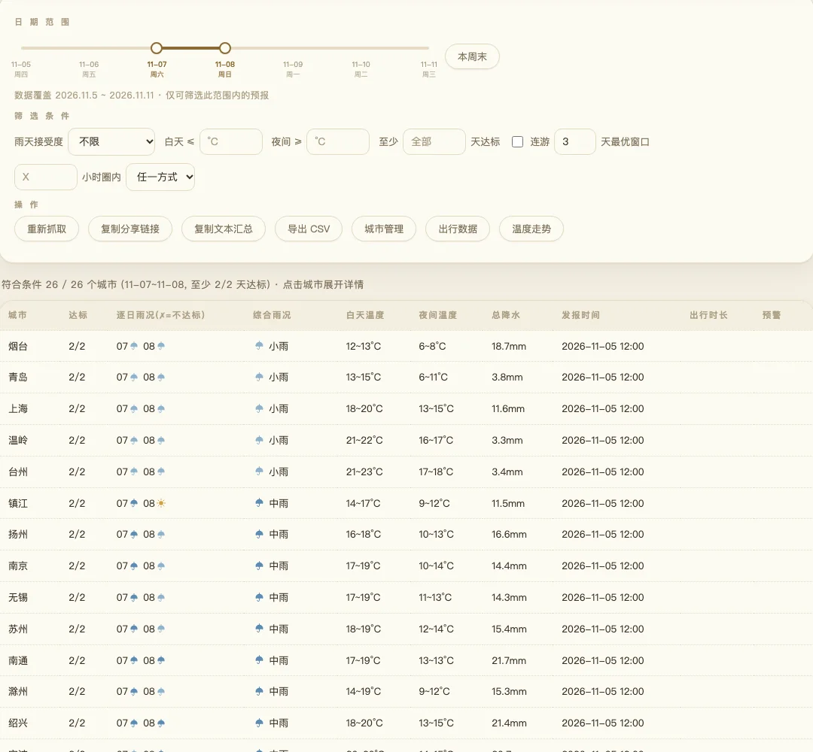
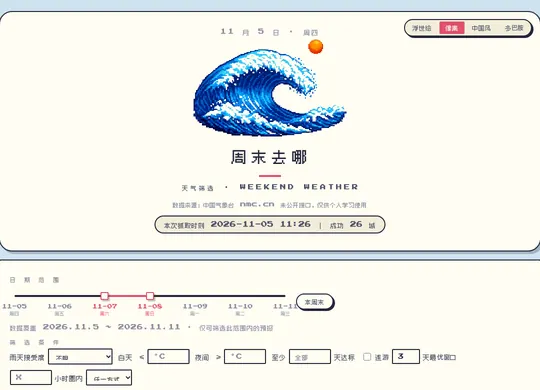

<p align="center">
  
</p>

<p align="center">
  <a href="https://tiatweather.netlify.app/"></a>
</p>

<p align="center">
  
  
  
  
  
</p>

<p align="center">
  <b>挑个周末能出门的城市。</b>26 座城市 × 未来 7 天预报，按雨天接受度、气温和连游天数一次筛完；网页版打开即用，命令行导出 CSV。
</p>

## 为什么用它

- **打开就出结果** — 网页版零构建，打开即抓 26 城 7 天预报，直接给「每城市一行」的行程汇总表。
- **按雨天做决策** — 雨天接受度四档，天气文字与降水量取更严重者兜底，避免「白天晴、降水 15 mm」被误判成好天。
- **连游自动找窗口** — 勾选「连游 N 天」，逐城扫描全部连续窗口，按最差天雨况 → 总降水 → 最高温排序。
- **断网也有兜底** — 直连 `nmc.cn` 失败自动读 GitHub Actions 每天 07:00 / 13:00 / 19:00 生成的 `data.json`，并标注「数据快照」。
- **城市自己定** — 按省勾选、搜索、导入导出文本（与 `cities.txt` 互通），选中列表和四套主题都存在浏览器本机。
- **命令行也能跑** — 1 个依赖 `requests`，`python3 filter_weather.py` 一条命令完成抓数、筛选和 CSV 导出。

## 截图

<p align="center">
  <a href="docs/screenshots/00-main.webp"></a>
</p>

<p align="center">
  
  
  
  
</p>

四套主题共用一个页面，点右上角标签即切换；点击主图可看原图。

## 快速开始

**网页版**：直接打开[在线版本](https://tiatweather.netlify.app/)（[GitHub Pages 备用入口](https://ignareo.github.io/WeekendWeather/)）。本地预览需要起静态服务，双击 `index.html` 不行——页面用 `fetch` 读 `stations.json`、`holidays.json` 和 `data.json`：

```bash
python3 -m http.server 8000
# 浏览器打开 http://127.0.0.1:8000/index.html
```

**命令行版**：Python 3 + `requests`，没有当日 CSV 时会自动先抓取，再进入筛选向导。

```bash
pip3 install requests
python3 filter_weather.py
```

## 功能

**看结果**
- 每城市一行：达标天数、逐日雨况、综合雨况、白天/夜间温度区间、总降水、发报时刻
- 点击城市名展开体感温度、湿度、AQI、日出日落、风向风力、气象预警详情
- 温度走势图叠加显示选中城市今天起 7 天的高/低温，点图例可显隐折线
- 预警徽标按蓝 / 黄 / 橙 / 红分级，点击展开并链接 NMC 原文

**挑时间**
- 双滑块选起止日期，刻度显示日期与星期，只能选预报覆盖范围内的日子
- 「本周末」「下周末」快捷选择；周四、周五打开默认选中本周末，假期中默认选中整个假期
- 「连游 N 天最优窗口」：范围改成可选窗口，逐城滑动扫描并选出最佳窗口，逐日格高亮窗口内天数

**设条件**
- 雨天接受度四档、白天温度上限、夜间温度下限、至少几天达标、出行小时圈
- 出行数据面板录入高铁 / 飞机 / 自驾时长，自动保存，可导出 / 导入 JSON
- 改动即时重算，不重新发请求；连游模式下「至少几天达标」自动禁用

**管城市**
- 按省分组勾选、搜索过滤、全选、恢复默认
- 导出 / 导入文本（每行一城市，与 `cities.txt` 互通），选中列表存 `localStorage`

**带走结果**
- 复制分享链接：城市和全部筛选条件编码进 URL，打开即还原视图并自动抓取
- 复制文本汇总（与命令行同格式）、导出 CSV
- 变更对比：每次抓取存快照，下次打开列出差异，雨况变坏置顶、温度变化 ≥ 3 °C 高亮；基准超 24 小时标注时间

**命令行**
- 批量导出 7 天预报 CSV（`utf-8-sig`，Excel 双击不乱码），可选 14 天气温 CSV
- 交互式筛选向导，逐项提问，直接回车 = 不限
- 导出 `*_summary.csv` 行程汇总，原始 CSV 不改动

<details>
<summary><b>输出样例与雨况判定</b></summary>

命令行筛选输出的是「每城市一行」，不再逐日罗列：

```text
城市    达标    逐日雨况(✗=不达标)    综合雨况      白天温度    夜间温度    总降水
景德镇  2/3     14🌧✗ 15☀️ 16☀️      🌧 中雨      28~33°C   22~25°C   10.0mm
```

- **逐日雨况**：每天一个图标，不达标的日子标 `✗`
- **综合雨况**：所选日期内最差的一档，决定行程下限的是最差那天
- **入选门槛**：达标天数 ≥ 设定值；一天「达标」= 雨况、温度等条件全部满足
- **排序**：达标天数多 → 少，综合雨况好 → 差，白天最高温低 → 高

雨况档位综合白天天气、夜间天气、降水量（mm），**取较严重者**（昼夜都算）：

| 档位 | 天气文字 | 24 h 降水量 | 旅游含义 |
|---|---|---|---|
| ☀️ 无雨 | 晴 / 多云 / 阴 | 0 | 随便玩 |
| 🌦 小雨 | 小雨 / 阵雨 / 小雪 | 0.1–9.9 | 带伞即可 |
| 🌧 中雨 | 中雨 / 雷阵雨 / 中雪 | 10–24.9 | 户外打折 |
| ⛈ 大到暴雨 | 大雨 / 暴雨 / 大暴雨 | ≥ 25 | 不宜出行 |

天气文字与降水量可能矛盾（如白天「晴」但降水 15 mm），取更严重的档位兜底，宁可保守。

</details>

## 使用提示

- **本地必须起 http 服务**：`file://` 下 `fetch` 读不到 JSON，页面会停在加载中。
- **筛选向导直接回车 = 不限**：日期支持 `8-16`、`8/16`、`08-16` 等写法，自动补全年份；非法输入原地重问，不中断。
- **城市找不到时**：优先精确匹配，其次前缀匹配，区县名（如 `昆山`）也可以；若大量城市失效，跑一次 `python3 nmc_weather.py refresh` 重建站点缓存。
- **CLI 选哪份数据**：默认用当天的 `weather_forecast_*.csv`，当天有多份取最新；`_filtered` / `_summary` 不会被当作数据源。
- **快照有新有旧**：预报每天约 06:00 / 12:00 / 18:00 发报三次，CSV 的「发布时刻」列标明本次数据的时次。
- **想复用城市清单**：网页版「城市管理 → 导出文本」的结果可直接粘进 `cities.txt`。

## 兼容性

| 项目 | 网页版 | 命令行版 |
|---|---|---|
| 运行前提 | 现代浏览器 + http 静态服务（或直接访问线上站点） | Python 3 + `requests` |
| 数据来源 | 浏览器直连 `nmc.cn`，失败回退 `data.json` | 脚本直连 `nmc.cn` |
| 输出 | 页面汇总表、分享链接、CSV | `weather_forecast_*.csv`、`*_summary.csv` |
| 连游最优窗口 | 支持 | 不支持（固定日期范围 + 至少几天达标） |
| 主题 | 浮世绘 / 像素 / 中国风 / 多巴胺 4 套 | 无 |

## 已知限制

- 数据来自国家气象中心**未公开接口**，随时可能变更或限流；数据使用受接口授权限制（目前仅作个人学习演示），本项目不提供可用性保证，也不分发官方数据集。
- 详细天气（风向、降水等）只有未来 **7 天**；`--temp14` 里的「前 7 天」是实况气温，不是预报。
- 网页版直连依赖浏览器跨域可用性；直连失败时读到的是 `data.json` 快照，可能落后于最新一次发报。
- `holidays.json` 目前只覆盖 2026 年法定节假日，过期后「下个法定节假日」快捷按钮不可用，页面会提示待更新；该按钮默认隐藏。
- Chart.js 与部分主题字体走 CDN，离线时温度走势图和字体降级，其余功能不受影响。
- 连游 N 天最优窗口为网页版特有；命令行版只支持固定日期范围筛选。
- 仓库暂无 Release，网页版通过静态托管直接提供，没有版本化分发包。
- **未验证**：Safari / Firefox 与移动端真机；命令行脚本未在本次文档核对中实跑。

<details>
<summary><b>命令参考与部署</b></summary>

```bash
python3 nmc_weather.py                    # 读 cities.txt，导出未来 7 天预报 CSV
python3 nmc_weather.py --temp14          # 额外导出 近 7 天实况 + 未来 7 天 气温 CSV
python3 nmc_weather.py --json data.json  # 导出网页版兜底快照（预报 + 实况 + 气温原始数据）
python3 nmc_weather.py refresh           # 重建 stations.json 站点缓存，约 40 秒
python3 filter_weather.py                # 自动选当日 CSV（没有则先抓取），进入筛选向导
python3 filter_weather.py <CSV 文件>      # 指定历史 CSV
```

示例：找 8.14–8.16 三天、最多接受小雨、白天 35 °C 以内的目的地——开始输 `8-14`，结束输 `8-16`，接受度选 `2`，白天温度上限填 `35`，「至少几天达标」回车（= 3 天全达标）或填 `2` 放宽。

抓取行为：重复城市自动去重；找不到的城市跳过并提醒，其余照常导出，结束时汇总失败列表并以退出码 1 结束；每城市仅 1 次请求、间隔 0.3 秒，30 个城市约 15 秒；每次生成带时间戳的新 CSV，互不覆盖。

`holiday3.py` 是一次性分析脚本，硬编码 2026 年国庆 10.01–10.07，对指定 CSV 做「连续 N 天最优窗口」统计（`python3 holiday3.py <CSV 文件> [N]`），是网页版连游窗口功能的原型，不是日常入口。

部署到静态托管（GitHub Pages / Netlify）时，根目录需同时包含：`index.html`、`stations.json`、`holidays.json`、`data.json`、`wave.png`、`wave-pixel.png`、`wave-cn.png`、`wave-dopa.png`、`zpix-subset.woff2`。GitHub Pages 在仓库 Settings → Pages 选分支根目录即可。

`data.json` 由 [`.github/workflows/weather-snapshot.yml`](.github/workflows/weather-snapshot.yml) 定时生成并提交：每天 UTC 23:00 / 05:00 / 11:00，对应北京时间 07:00 / 13:00 / 19:00；也可在 Actions 里手动触发。

</details>

<details>
<summary><b>项目结构与实现要点</b></summary>

| 文件 | 作用 | 是否需要维护 |
|---|---|---|
| `index.html` | 网页版单文件 SPA，浏览器内完成抓取 → 筛选 → 汇总 → 图表 | 否，改功能才动 |
| `nmc_weather.py` | 按城市列表抓预报，导出 CSV / 网页兜底快照 | 否 |
| `filter_weather.py` | 对结果 CSV 做交互式条件筛选 | 否 |
| `holiday3.py` | 国庆连续 N 天窗口分析（原型脚本，硬编码 2026 年） | 否 |
| `cities.txt` | 城市列表，一行一个，支持 `#` 注释；默认 26 城 | **是，按需编辑** |
| `stations.json` | 全国 2522 个站点代码缓存 | 否，脚本生成 |
| `holidays.json` | 法定节假日数据 | **是，每年国务院发布后更新** |
| `data.json` | 网页兜底快照，Actions 定时提交 | 否 |
| `wave*.png` | 四套主题的海浪 / 水墨插画 | 否 |
| `zpix-subset.woff2` | 像素主题点阵中文字体子集 | 否 |
| `docs/` | README 横幅与截图 | 否 |

关键设计：

- 单文件 SPA，无打包、无框架；Chart.js 走 CDN，加载失败不影响其他功能。
- 雨况档位取「天气文字 / 昼夜 / 降水量」中最严重者，避免单一维度误判。
- 站点代码缓存在 `stations.json`，城市名按精确 → 前缀 → 区县顺序匹配。
- 快照 `data.json` 只在直连失败时读取，前端不主动请求定时任务。
- 主题、城市、筛选条件、出行时长、对比快照全部存浏览器 `localStorage`，不上传。
- 分享链接把城市与全部筛选条件编码进 URL，打开即还原视图。
- CSV 统一 `utf-8-sig`，Excel 双击打开不乱码；`*.csv` 已在 `.gitignore` 中忽略。

</details>

## 已验证

- Chrome 156（桌面 1200 px / 窄屏 440 px）：四套主题均正常渲染，汇总表可显示 26 城数据（2026-11-05）。
- GitHub Actions `weather-snapshot.yml` 最近三次定时运行均成功（2026-11-04 ~ 11-05），`data.json` 保持更新。
- Netlify 与 GitHub Pages 两个线上入口均返回 200（2026-11-05）。
- **未验证**：Safari / Firefox、移动端真机、NMC 接口变更后的恢复流程；命令行脚本本次未实跑。

## 数据来源与致谢

- 天气与预警数据：中国气象台 `nmc.cn` 未公开接口。接口未获授权，仓库对数据的使用仅作个人学习演示，可随时停止；如需商用请自行取得数据授权。仓库内的 `data.json` 只是直连失败时的兜底快照，不是离线分发的数据集。
- 法定节假日：[`holidays.json`](holidays.json) 依据国务院办公厅国办发明电〔2025〕7 号整理，目前只覆盖 2026 年，新安排发布后需手工更新。
- 温度走势图：Chart.js 4（CDN，MIT）；部分主题字体来自 Google Fonts（CDN）。
- 像素主题使用 [`zpix-subset.woff2`](zpix-subset.woff2) 点阵字体子集；四套主题插画为仓库自带素材，二者的来源与授权状态**未在仓库中注明**，商用前请自行核对，如涉及第三方权利请联系移除。

> 第三方内容与数据归各自权利人所有。本项目不隶属于中国气象局，预报结果仅供参考，出行决策请以官方发布为准。

## 许可

本仓库代码与文档采用 [MIT](LICENSE) 许可，Copyright (c) 2026 Ignareo。

> MIT 只覆盖仓库内的代码与文档。天气数据来自 `nmc.cn` 未公开接口，主题字体与插画的授权状态见上文「数据来源与致谢」；这些第三方内容归各自权利人所有，不随代码一并授权。

## 更多

- 在线版本：[Netlify](https://tiatweather.netlify.app/) · [GitHub Pages](https://ignareo.github.io/WeekendWeather/)
- 许可全文：[LICENSE](LICENSE)
- 快照工作流：[`weather-snapshot.yml`](.github/workflows/weather-snapshot.yml)
- 问题与建议：[Issues](../../issues)
- 版本变更：见提交历史（暂无 CHANGELOG）
